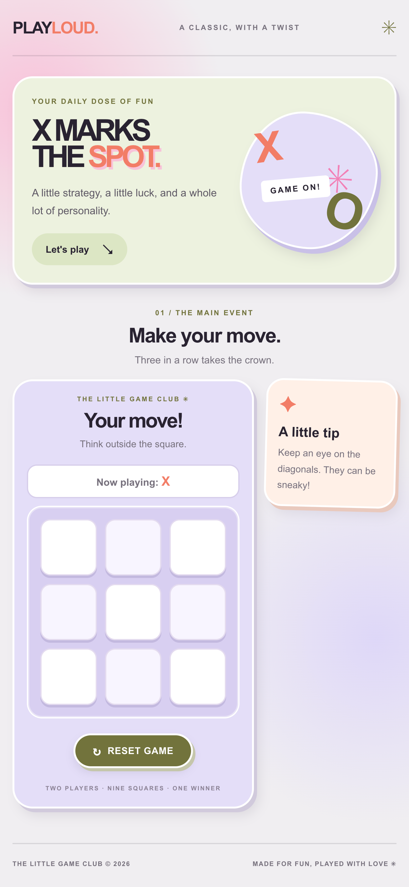

# ✳ Tic-Tac-Toe — Play Loud

A classic Tic-Tac-Toe game with a **maximalist editorial aesthetic**, featuring pastel colors, playful typography, rounded cards, and layered shadows.

Built with React as part of my front-end development learning journey.

## 🎮 Preview

<!-- Add a screenshot of your game here once you have one. -->



## ✨ Features

- Interactive 3 × 3 game board
- Two-player gameplay with alternating X and O turns
- Automatic winner detection
- Draw detection
- Reset button to start a new game
- Responsive layout for different screen sizes
- Custom maximalist design with pastel colors and playful details

## 🛠️ Built With

- React
- JavaScript (ES6+)
- CSS3
- Vite
- HTML5

## 🎨 Design

The design combines pastel colors, bold typography, rounded cards, and layered shadows for a playful editorial-inspired look.

| Color      | Hex Code  |
| ---------- | --------- |
| Pink       | `#F280B6` |
| Lavender   | `#E4DEF8` |
| Coral      | `#F27D67` |
| Sage Green | `#DCE6C4` |
| Olive      | `#71733C` |
| Cream      | `#F7F5F0` |

## 🚀 Getting Started

### Prerequisites

- [Node.js](https://nodejs.org/)
- npm

### Installation

1. Clone the repository:

   ```bash
   git clone YOUR_REPOSITORY_URL
   ```

2. Navigate to the project folder:

   ```bash
   cd tic-tac-toe
   ```

3. Install dependencies:

   ```bash
   npm install
   ```

4. Start the development server:

   ```bash
   npm run dev
   ```

5. Open the local URL shown in your terminal.

## 🕹️ How to Play

1. Player X starts the game.
2. Players take turns selecting an empty square.
3. The first player to get three marks in a row, column, or diagonal wins.
4. If all nine squares are filled without a winner, the game ends in a draw.
5. Click **Reset Game** to play again.

## 📚 What I Learned

- Creating reusable React components
- Managing state with `useState`
- Rendering lists with `map()`
- Handling click events
- Updating arrays without mutating state
- Implementing game logic and winner detection
- Styling responsive layouts with CSS Grid and Flexbox
- Using CSS variables, transitions, and media queries

## 🔮 Future Improvements

- Add a score tracker
- Highlight the winning combination
- Add sound effects and animations
- Introduce additional color themes
- Add a computer opponent

## 👩‍💻 Author

Created as part of my journey learning React and front-end development.

More projects coming soon! ✨
